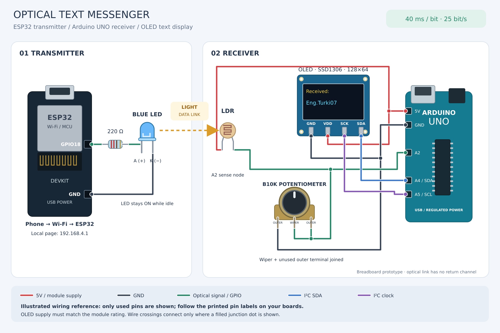
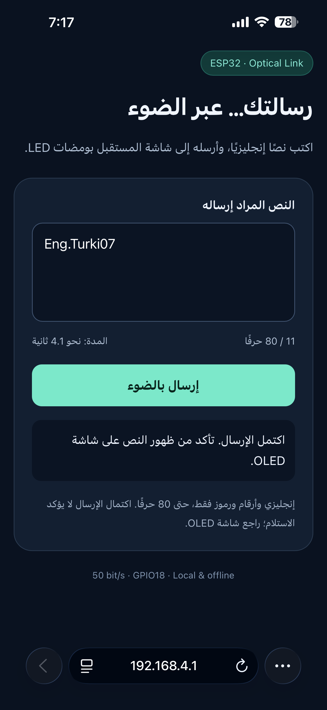
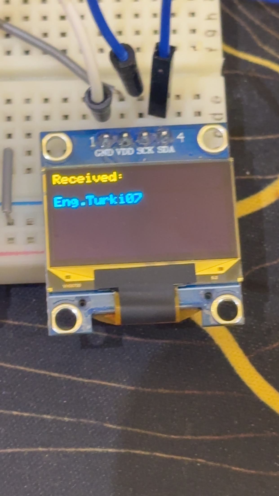
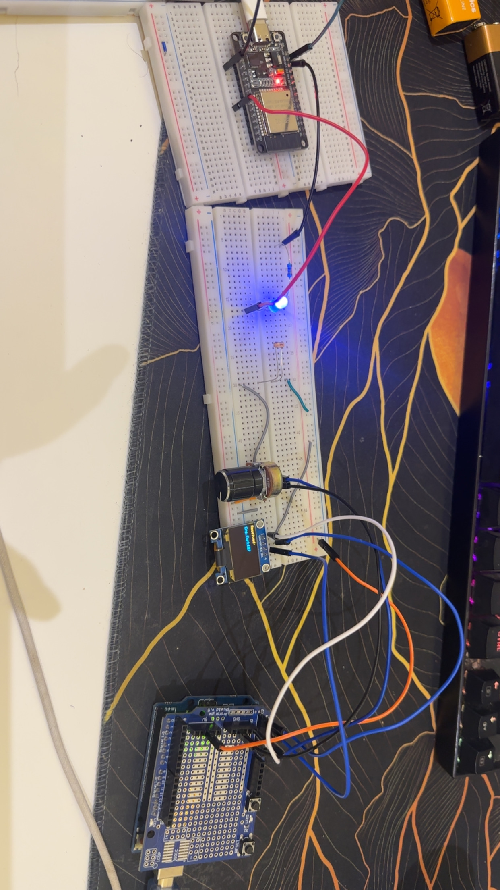
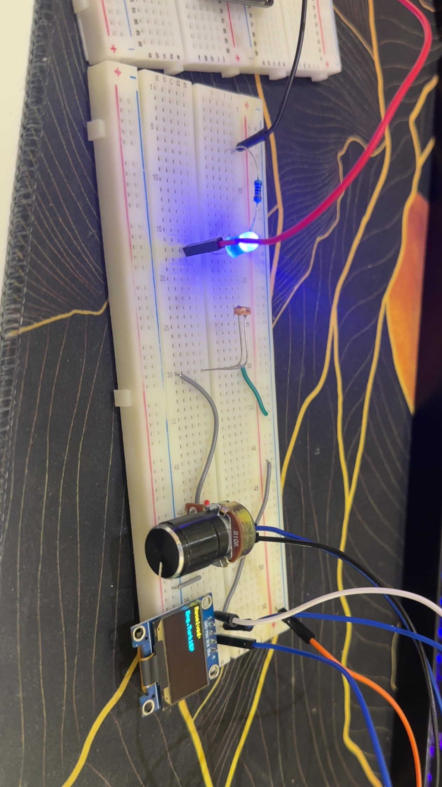
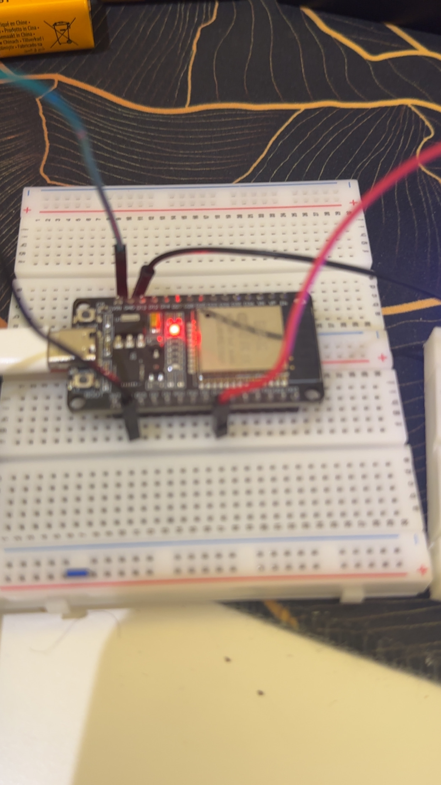
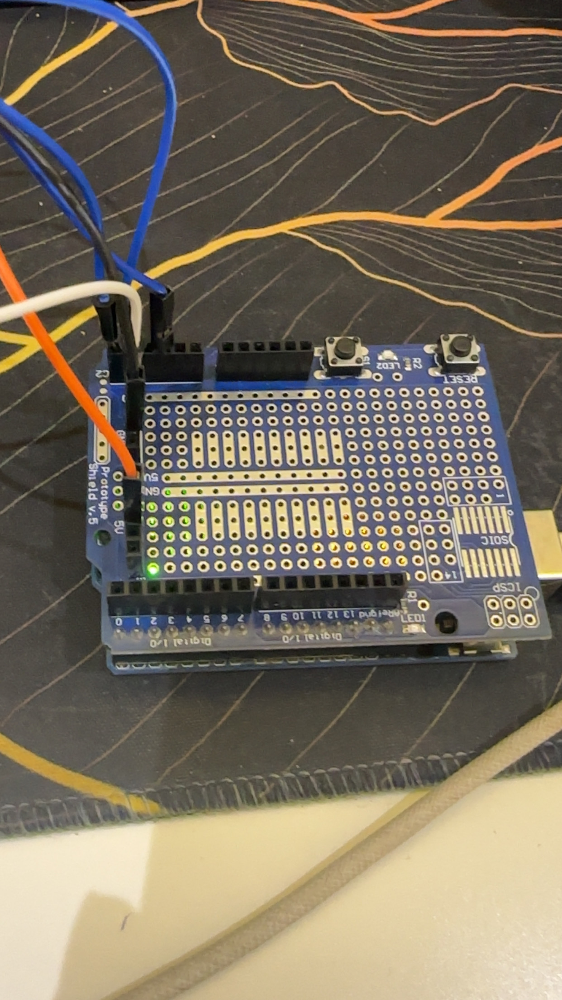

# Optical Text Messenger

**Send a message from a phone browser, transmit it through an LED, and read it on an Arduino-connected OLED.**

This project demonstrates a short-range visible-light communication (VLC) link using an ESP32 transmitter and an Arduino UNO receiver. A local web page supplies the message to the ESP32 over Wi-Fi. The ESP32 then sends the text as timed LED pulses; an LDR circuit detects the light, and the UNO reconstructs and displays the text.

The phone-to-ESP32 connection uses Wi-Fi. The ESP32-to-UNO data link uses light. This is an educational optical text link, rather than a standards-compliant Li-Fi network.

[Download the editable SVG](images/wiring-diagram.svg). Pin positions are simplified; follow the labels printed on the actual boards.

## Demonstration

The prototype was assembled and tested on breadboards. The builder confirmed successful operation at **40 ms per bit (25 bit/s)**. The screenshots below document the message `Eng.Turki07` entered on the phone and displayed on the receiver.

| Phone input | Receiver output |
| :---: | :---: |
|  |  |

*The page's completed status means the transmitter finished sending. The OLED provides the visible reception result; the optical link does not send acknowledgements back to the phone.*

## Features

- Local phone interface hosted by the ESP32; no internet connection or external hosting required.
- Up to 80 printable ASCII characters per message in the supplied web-interface implementation.
- One transmission per press of the Send button.
- LED on/off signaling with software-timed byte framing.
- Adjustable LDR voltage-divider circuit using a 10 kΩ potentiometer.
- OLED display of the last completed message.
- Detection of some framing, timeout, length and invalid-character errors.

## Hardware

| Component | Purpose |
| --- | --- |
| ESP32 development board | Hosts the web page and drives the transmitting LED |
| Arduino UNO | Samples the optical receiver and reconstructs the text |
| Visible LED | Optical transmitter; the photographed build uses a blue LED |
| 220 Ω resistor | Series current limiting for the LED, as specified during assembly |
| LDR / photoresistor | Detects changes in received light |
| B10K potentiometer | Adjusts the receiver voltage divider; visible in the build photos |
| SSD1306 128×64 I²C OLED | Displays received text |
| Breadboards and jumper wires | Prototype construction |
| Arduino prototyping shield | Connection breakout on the photographed UNO |
| Suitable power supplies / USB leads | Power for the two boards |

## Wiring

These tables describe the wiring used in the project instructions. They are not a pin-by-pin reconstruction from photographs.

### ESP32 transmitter

| Connection | Destination |
| --- | --- |
| GPIO18 | 220 Ω resistor, then LED anode (+) |
| LED cathode (−) | ESP32 GND |

### Arduino UNO optical input

| Connection | Destination |
| --- | --- |
| UNO 5V | First LDR lead |
| Second LDR lead | UNO A2 and potentiometer wiper (center terminal) |
| One outer potentiometer terminal | UNO GND |
| Remaining outer potentiometer terminal | Potentiometer wiper |

The potentiometer acts as a variable resistance from A2 to ground. With this divider orientation, brighter light lowers the LDR resistance and increases the voltage at A2. The LDR has no polarity.

### OLED

| OLED terminal | UNO terminal |
| --- | --- |
| GND | GND |
| SDA | A4 |
| SCK / SCL | A5 |
| VDD / VCC | Supply appropriate for the particular OLED module |

The receiver probes addresses `0x3C` and `0x3D`. Keep the OLED supply arrangement that worked on the actual module. The two boards have their own supplies; no electrical data connection is needed between them.

## How the optical protocol works

An illuminated LED represents logical `1`; a dark LED represents logical `0`. The LED stays on while idle. Each byte uses:

| Stage | Signal | Duration |
| --- | --- | --- |
| Start | LED off | 1 bit period |
| Data | Eight bits, least significant bit first | 8 bit periods |
| Stop | LED on | 1 bit period |
| Additional gap | LED on | 2 bit periods |

The receiver checks the start bit at approximately half a bit period, reads the eight data bits near their centers, and checks the stop bit. A newline byte marks the end of a message. The OLED is updated after the complete message, avoiding display transfers during byte reception.

Before each message, the web transmitter holds the LED on for 1.2 seconds. The matching receiver requires at least one second of steady light to arm for a new message. This helps reject startup transitions. It is a simple idle-based synchronization method, not a robust packet synchronization or error-correction system.

For example, ASCII `H` has decimal value 72 and binary representation `01001000`. The data bits are transmitted in chronological order as `0, 0, 0, 1, 0, 0, 1, 0`.

## Calibration and timing

The initial receiver readings were approximately 69–82 with the transmitting LED off and 97–108 with it on. A threshold of `90` was selected between these groups. These are ADC counts from the initial setup, not calibrated light measurements. Alignment, ambient light and potentiometer adjustment can change them.

The final confirmed setting is **40 ms per bit**, corresponding to **25 bit/s**. The simple prototype was also tested at 20 ms, while 10 ms failed in the reported trial. Intermittent errors during development led to the final 40 ms setting.

The supplied phone screenshot was captured with the older UI label of 50 bit/s and its old duration estimate. The published firmware updates both to match 40 ms per bit. The screenshot documents the interface and test text; its old label is not a measured data rate.

| Configuration | Bit rate | Time per framed byte | Estimated time for 1,000 payload bytes* |
| --- | ---: | ---: | ---: |
| 20 ms per bit | 50 bit/s | 240 ms | 4 minutes |
| 40 ms per bit | 25 bit/s | 480 ms | 8 minutes |

*Calculated values, not measured file-transfer results. They include the 12 bit periods per byte and exclude the per-message synchronization interval, newline and retries. The current interface accepts up to 80 characters, not a 1,000-byte message.*

Both firmware files must use matching periods. On the ESP32 this is `BIT_MS`; on the UNO it is `BIT_US`, in microseconds.

## Operation

1. Open [`firmware/UNO_OLED_RX/UNO_OLED_RX.ino`](firmware/UNO_OLED_RX/UNO_OLED_RX.ino) and upload it to the UNO. Install **Adafruit SSD1306** and **Adafruit GFX Library**, including required dependencies.
2. Open [`firmware/ESP32_Optical_TX/ESP32_Optical_TX.ino`](firmware/ESP32_Optical_TX/ESP32_Optical_TX.ino) and upload it to the classic dual-core ESP32 DevKit. WiFi and WebServer are included with its Arduino board package.
3. Power both boards and align the LED with the LDR.
4. Connect the phone to the ESP32 access point, **Optical-TX**.
5. Open **http://192.168.4.1** in the phone browser. The supplied firmware's default Wi-Fi password is `Light2026`.
6. Enter a short English message and press Send. Remain connected even though the Wi-Fi network has no internet access.
7. Confirm that the same message appears on the OLED.

The system waits for a button press on the page; it does not automatically repeat `HELLO`. New messages replace the previously displayed message after reception completes.

## Build photos

Show complete prototype and hardware close-ups

### Complete prototype

### Optical transmitter and receiver circuit

### ESP32 transmitter

### Arduino receiver

## Results and limitations

| Item | Evidence / status |
| --- | --- |
| Phone text entry | Documented in the supplied browser screenshot |
| Text displayed on OLED | Documented in the supplied receiver photograph |
| Working prototype | Confirmed by the builder |
| Construction stage | Breadboard prototype; permanent soldered assembly is not shown |
| Final bit period | 40 ms, confirmed by the builder; 25 bit/s calculated |
| Maximum reliable distance | Not measured |
| Bit / message error rate | Not measured |
| Delivery acknowledgement | Not implemented |
| CRC / checksum | Not implemented in the supplied implementation |

The OLED's yellow header and blue text in the photos come from the display panel's physical color regions, not RGB color commands.

The LDR response, ambient lighting and receiver threshold limit reliable operation. The current checks cannot detect every corrupted data byte, and a message can contain a wrong printable character without a framing error. Successful reception of the photographed message does not establish error-free operation over all messages or conditions. The text path supports printable ASCII, not Arabic text or emoji.

## Next improvements

- Record the final firmware settings and test repeated messages under fixed conditions.
- Measure successful reception versus distance and ambient light.
- Add explicit packet framing, sequence numbers and CRC.
- Consider a faster photodiode receiver with a suitable amplifier for higher rates.
- Transfer the validated circuit to a soldered prototype board.

## Repository files

| Path | Contents |
| --- | --- |
| `firmware/ESP32_Optical_TX/` | ESP32 access point, phone UI and optical transmitter |
| `firmware/UNO_OLED_RX/` | UNO optical receiver and OLED display |
| `images/wiring-diagram.png` | Illustrated circuit wiring |
| `images/wiring-diagram.svg` | Editable vector version of the wiring drawing |
| `images/` | Original implementation photos and phone screenshot |
| `docs/SETUP_AR.md` | Arabic setup and troubleshooting guide |
| `docs/PROTOCOL.md` | Timing, framing and HTTP API reference |

The firmware is based on the implementation used during the build, with the confirmed 40 ms timing and matching web-page labels. Hardware operation was confirmed by the builder; maximum range and error rates have not been characterized. The packaging checks cover message framing, timing consistency, the embedded page syntax and file links; they are not a substitute for compilation or testing on the boards.

## References

- [Espressif Arduino-ESP32](https://github.com/espressif/arduino-esp32)
- [Adafruit SSD1306 library](https://github.com/adafruit/Adafruit_SSD1306)
- [Adafruit GFX library](https://github.com/adafruit/Adafruit-GFX-Library)

Project photos and the final working-prototype confirmation were supplied by the builder.
